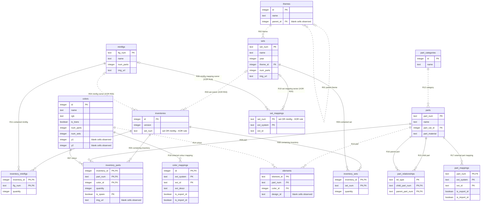

## Task 1 CSV Analysis

**Lead:** Suhamri, Taccad 
**Status:** Reviewed

This document analyses the supplied Rebrickable CSV files
and records the differences from Figure 4 in the assignment.

### What the files actually contain: 
| File/table | Data rows | Proposed primary key |
|---|---:|---|
| colors | 275 | id |
| elements | 114,315 | element_id |
| inventories | 47,597 | id |
| inventory_minifigs | 25,831 | inventory_id + fig_num |
| inventory_parts | 1,558,562 | inventory_id + part_num + color_id + is_spare |
| inventory_sets | 5,212 | inventory_id + set_num |
| minifigs | 17,229 | fig_num |
| parts | 64,680 | part_num |
| part_categories | 76 | id |
| part_relationships | 37,438 | rel_type + child_part_num + parent_part_num |
| sets | 28,417 | set_num |
| themes | 496 | id |

### Additional columns absent from Figure 4

| CSV file | Additional columns |
|---|---|
| parts.csv | part_material |
| sets.csv | img_url |
| minifigs.csv | img_url |
| inventory_parts.csv | img_url |
| elements.csv | design_id |
| colors.csv | num_parts, num_sets, y1, y2 |

## Source database ER diagram 

### Key and relationship explanations 
- `inventory_parts` uses the composite key
  `(inventory_id, part_num, color_id, is_spare)`.
  Including `is_spare` distinguishes normal and spare entries
  for the same part and colour in an inventory.
- `inventories.set_num` can identify either a set or a minifigure.
  This differs from Figure 4, which shows only the set relationship.
- `inventory_sets.set_num` identifies a set contained in an
  inventory, rather than the inventory's owner.
- `themes.parent_id` is optional because root themes have no parent.
- Set, part and minifigure identifiers are stored as text to
  preserve letters, hyphens and leading zeroes.

### Diagram notation

- PK means primary key; FK means foreign key.
- Multiple PK fields together form one composite key.
- `||` means exactly one; `o|` means zero or one;
  `o{` means zero or many.
- The two inventory-owner relationships are exclusive alternatives:
  each inventory belongs to exactly one set OR one minifigure.

### Scope

This diagram models the supplied Rebrickable CSV data.
The application's collection tables belong to Task 3.
  
