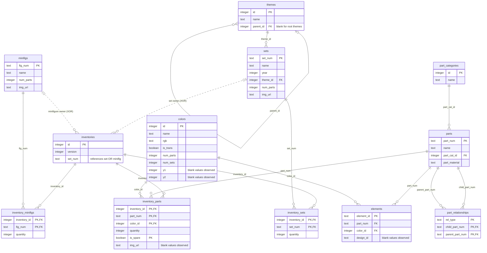

## Task 1 CSV Analysis

**Lead:** Suhamri, Taccad 
**Status:** In progress 

This document analyses the supplied Rebrickable CSV files
and records the differences from Figure 4 in the assignment.

## What the files actually contain: 
  File/table          | Data rows | Proposed primary key |
| colors              | 275       | id                   |
| elements            | 114,315   | element_id           |
| inventories         | 47,597    | id                   |
| inventory_minifigs  | 25,831    | inventory_id + fig_num |
| inventory_parts     | 1,558,562 | inventory_id + part_num + color_id + is_spare |
| inventory_sets      | 5,212     | inventory_id + set_num |
| minifigs            | 17,229    | fig_num                |
| parts               | 64,680    | part_num               |
| part_categories     | 76        | id                     |
| part_relationships  | 37,438    | rel_type + child_part_num + parent_part_num |
| sets                | 28,417    | set_num                |
| themes              | 496       | id

CSV file  |  Additional columns absent from Figure 4
parts.csv  |  part_material
sets.csv  |  img_url
minifigs.csv  |  img_url
inventory_parts.csv  |  img_url
elements.csv  |  design_id
colors.csv  |  num_parts, num_sets, y1, y2

## Source database ER diagram 

Each inventory belongs to exactly one set OR one minifigure.
The two owner relationships are exclusive alternatives (XOR),
not two simultaneously enforced SQL foreign keys.

Fields marked PK together form one composite primary key.
Keys and relationships are proposed from analysis of the CSV data.
