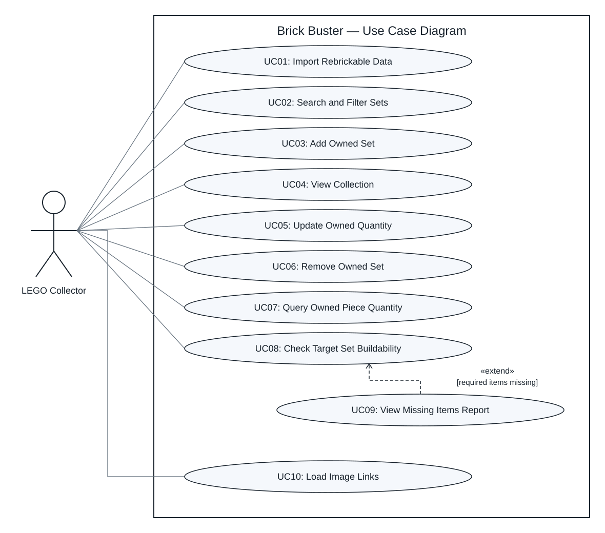

## Task 2 — Requirements Gathering

Project:Brick Buster — ZEIT2105 Assignment 2  

Status:Final — approved by the team  

Prepared: 13 October 2026   

Revised: 15 October 2026 

Author:Sazmi

## Purpose and actor

Brick Buster helps a LEGO collector manage complete owned sets, query available pieces and check whether if the collection can build a selected target set. The application uses Python, a graphical interface and a local SQLite database populated from Rebrickable CSV files.

The primary actor is the LEGO Collector who manages the collection, performs searches and build checks and imports local catalogue data. Optional images support identification of catalogue and collection items.

## Prioritised functional requirements

Must requirements provide the compulsory functionality. Should requirements are selected enhancements included in this version. Could requirements are possible future enhancement. Won't requirements are excluded from this version.

| ID | Requirement | Priority | Scope | Use case |
|---|---|---|---|---|
| FR01 | Import the necessary Rebrickable CSV data into SQLite. | Must | Implement | UC01 |
| FR02 | Search sets by set number or name and optionally filter by theme and year. | Should | Implement | UC02 |
| FR03 | Add a complete owned set and record a positive whole-number copy quantity. | Must | Implement | UC03 |
| FR04 | View owned sets and their copy quantities. | Should | Implement | UC04 |
| FR05 | Replace a set's owned copy quantity with a calid positive whole number. | Should | Implement | UC05 |
| FR06 | Remove a set entry from the collection. | Should | Implement | UC06 |
| FR07 | Search/select a part and color and query the total available quantity across all owned copies. | Must | Implement | UC07 |
| FR08 | Check whether sufficient matching parts, colours and complete minifigures are available to build one selected target set. | Must | Implement | UC08 |
| FR09 | Show missing parts and minifigures with identifiers, names, colours where applicable, and required, available and missing quantities. | Should | Implement | UC09 |
| FR10 | Find all sets buildable from the collection. | Could | Exclude | — |
| FR11 | Export missing items to CSV. | Could | Exclude | — |
| FR12 | Purchase missing items or integrate with shopping services. | Won’t | Exclude | — |
| FR13 | Switch collection, set search, part selection and missing report results between a scrollable list table and a grid with optional thumbnails. | Should | Implement | UC02, UC04, UC07, UC09 |
| FR14 | Load image links from an original Rebrickable ZIP into existing catalogue records without changing owned quantities or catalogue item identities. | Should | Implement | UC10 |

## Quality requirements

| ID | Requirement | Verification |
|---|---|---|
| NFR01 | Collection changes persist after restarting the application. | Add, update and remove entries as well as restart and verify the saved collection. |
| NFR02 | Invalid copy quantities are rejected without changing stored collection data. | Enter zero, negative, fractional and nonnumeric quantities. |
| NFR03 | The GUI uses consistent navigation and gives clear success, empty-result and error messages. | Walk through each use case and inspect its feedback. |
| NFR04 | Collection queries and build checks work offline after successful data import. | Disconnect the network and perform those operations. |
| NFR05 | Missing or invalid source data produces a clear error rather than a misleading build result. | Attempt import/checks with missing or invalid required data. |
| NFR06 | Missing, unsupported or unavailable images show a placeholder and do not prevent result selection, collection actions or calculations. | Open Grid with unavailable image links and verify that records remain selectable and actions remain usable in order to verify cached thumbnails can be reused offline. |

## Business rules and scope

- **Collection:** Owned sets are complete and entered copy quantities multiply their contents. Adding increments the quantity, updating replaces it and removal require confirmation.
- **Matching:** Parts match by part number and color. Complete minifigures match by fig_num. Spare parts and minifigure component parts are excluded from loose part totals.
- **Inventories:** Use the highest numeric inventory version and multiply nested set contents by their quantities. Missing inventories, cycles or overlapping direct/nested contents produce an error.
- **Build** **checks:** Check one target copy by using all owned pieces which includes those from assembled sets. Checks do not consume pieces. Every required item must have zero shortage to be buildable.
- **Fresh results:** Collection changes and catalogue reimports require a new build checks. Optional image link imports update existing records without changing owned quantities.
- **Search and display:** Searches show up to 500 sets or 300 parts. List uses scrolling while Grid shows up to 12 items per page.
- **Data import:** Catalogue import accepts the required local CSV or individual CSV ZIP files. Image link import uses a ZIP which contains sets.csv, minifigs.csv and inventory_parts.csv.
- **Excluded scope:** User accounts, loose piece editing, incomplete sets, simultaneous build planning, automatic entry from instruction photos and shopping integrations are excluded.

## Use case specifications

| ID | Use case | Preconditions | Main interaction and outcome | Alternative/error |
|---|---|---|---|---|
| UC01 | Import Rebrickable Data | Required CSV files are accessible. | Collector starts import, system validates and loads necessary data then reports completion. | Missing/invalid files: report failure, do not mark incomplete data ready for use. |
| UC02 | Search and Filter Sets | Catalogue imported. | Collector enters a number/name and optional theme/year filters, system displays matching sets for selection. | No matches: show an empty-result message and allow criteria changes. |
| UC03 | Add Owned Set | Catalogue imported and a set selected. | Collector enters copy quantity then system saves the owned set and confirms the result. For an existing entry, add the entered copies to its quantity. | Invalid quantity: reject and retain the previous collection. |
| UC04 | View Collection | Application is open. | Collector opens the collection; system lists owned sets and quantities. | Empty collection: show a message and an Add Set action. |
| UC05 | Update Owned Quantity | An owned entry exists. | Collector selects an entry and enters its replacement quantity and the system saves the change. | Invalid quantity: reject, use Remove Owned Set to delete the entry. |
| UC06 | Remove Owned Set | An owned entry exists. | Collector selects an entry and confirms removal, system deletes it and refreshes the collection. | Cancellation leaves the entry unchanged. |
| UC07 | Query Owned Piece Quantity | Catalogue and inventories imported. | Collector selects a part and color then the system totals matching non-spare parts across owned copies and displays the quantity. | None owned: display zero. Missing inventory data: display an error. |
| UC08 | Check Target Set Buildability | Target selected required inventory data available. | Collector starts the check and the system compares required parts and minifigures with available quantities and displays buildable/not buildable. | Shortages: UC09 extends this use case. Missing data: report that the check cannot be completed. |
| UC09 | View Missing Pieces Report | UC08 identifies at least one shortage. | System displays all missing parts and complete minifigures, including required, available, and missing quantities. | If no shortage exists, this extension is not triggered. |
| UC10 | Load Image Links | Catalogue imported and an original Rebrickable ZIP containing the three required image CSVs is accessible. | From the import screen the collector selects the ZIP. The system loads nonblank image links for matching existing records and reports the number updated, preserving catalogue identities and owned quantities. | Missing required CSVs/columns, malformed rows or invalid spare flags: Report an error and roll back image updates. Blank links and unmatched identifiers are skipped. |

## Use case relationships

- UC09 View Missing Items Report. UC08 Check Target Set Buildability when required items are missing.
- UC10 Load Image Links is an independent optional action available after catalogue import.
- List/Grid switching and Grid pagination are alternative presentations within UC02, UC04, UC07 and UC09. They do not require a separate actor goal use cases.
  
## Acceptance criteria

1. Two owned copies double inventory quantities. Saved collection changes survive restart and invalid quantities leaves stored data unchanged.
2. Part colors and minifigures identifies must match exactly. A missing required minifigure produces "NOT BUILDABLE" even when all loose parts are available.
3. Five required items with three available show two missing. An empty collection returns zero owned quantities and all target requirements as missing.
4. Totals use the latest inventory, apply nested quantities and exclude spares and minifigure components. Any invalid inventory structures show an error.
5. Set number/name searches and theme/year filters return matching sets which includes child themes when a parent is selected.
6. Switching List/Grid preserves selection. A 13 item result uses Grid pages containing 12 items and 1 item.
7. Unavailable images show placeholders while collection action and calculations remain usable offline. Image link imports preserve identities and owned quantities which is invalid required file structures roll back updates.
8. Failed catalogue reimports preserve existing data. Any successful reimports or collection changes require a new GUI build chceck.

## Use case diagram

